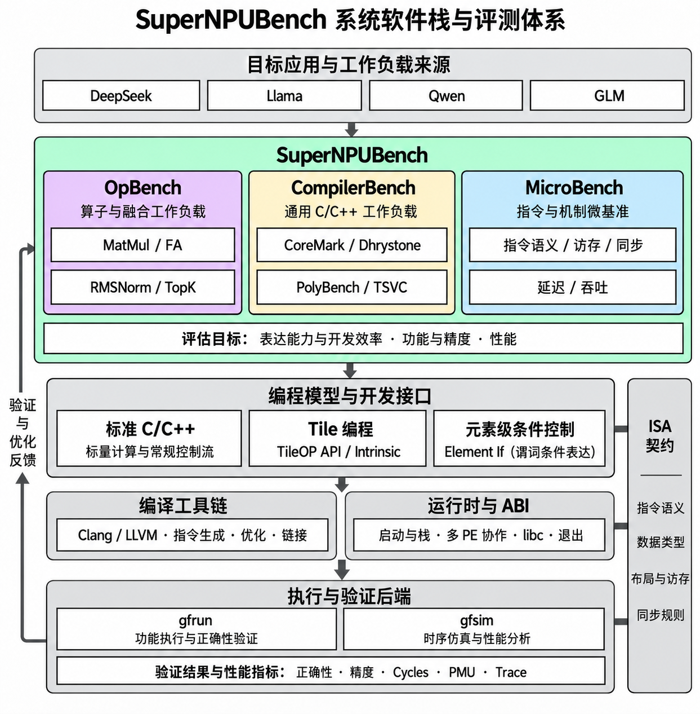

# SuperNPUBench Startup

更新日期：2026-11-12。本文介绍 SuperNPUBench 的系统结构与开发环境，并以 matmul 为例，串起源码、编译、功能验证、时序执行和性能分析的完整流程。

## 1 系统全景



沿图自上而下阅读：

1. **目标应用与工作负载来源**：DeepSeek、Llama、Qwen、GLM 等应用提供有代表性的计算需求。
2. **SuperNPUBench 评测层**：OpBench 关注算子与融合工作负载；CompilerBench 关注通用 C/C++ 工作负载；MicroBench 关注指令、访存、同步、延迟与吞吐。评估覆盖表达能力与开发效率、功能与精度、性能。
3. **编程模型与开发接口**：标准 C/C++ 表达标量计算和控制流，Tile API / Intrinsic 表达分块计算，Element If 表达元素级条件控制。
4. **编译工具链与运行时**：Clang / LLVM 完成优化、代码生成和链接；运行时与 ABI 支撑程序启动、栈、多 PE 协作、运行库及退出。
5. **执行与验证后端**：gfrun 检查功能与正确性，gfsim 提供时序仿真和性能分析。正确性、精度、Cycles、PMU 与 Trace 形成反馈，指导上层算子和编译优化。

ISA 契约贯穿编程接口与执行后端，约束指令语义、数据类型、布局与访存、同步规则。图中的工作负载是体系分类与示例，具体支持范围以对应分支和测试结果为准。

### 图中各层与仓库的对应关系

pto-spec 定义 PTO ISA 的架构语义与合法性契约；算子仓承载工作负载、测试与 Golden；工具链仓组织 LLVM、TileOP API 和运行库；模型仓提供功能执行与时序建模。ELF 是编译器与模型之间的交接物。成功编译、程序退出、数值正确、性能改善是四项不同结论，必须分别记录。

| GitHub 仓库 | 职责 | 新人首先阅读 |
| --- | --- | --- |
| [pto-spec](https://github.com/PTO-ISA/pto-spec) | PTO ISA 可执行 ASL 规范；定义指令、架构状态、合法性、完成与内存顺序 | 架构总览、Tile 指令语义 |
| [SuperNPUBench](https://github.com/PTO-ISA/SuperNPUBench) | 算子、测试、Golden、编译配置、回归与性能证据 | 根 README 和 AGENTS，以及一个算子的测试与实现 |
| [linx-toolchain-build](https://github.com/LinxISA/linx-toolchain-build) | 聚合 LLVM、musl、TileOP API 等组件并安装工具链 | README、Makefile、组件版本 |
| [SuperScalarModel](https://github.com/LinxISA/SuperScalarModel) | ISA 解码、gfrun 功能执行与 gfsim 时序模型 | README、modelSpec、TimingSim |

pto-spec 对应全景图右侧的 **ISA 契约**，为编程接口、编译生成和模型功能行为提供共同依据。它不定义具体硬件流水线、物理 Tile 分配、延迟或吞吐；这些实现与性能问题需要结合模型仓分析。

gfrun 与 gfsim 均来自 SuperScalarModel 仓库，分别用于功能验证和性能分析。具体执行环境见后文的环境配置。

## 2 硬件架构与 Tile 编程

### 计算引擎与存储如何协作

本文以当前 one-level 架构下的四 PE 协作 matmul 为例。这里说明算子可见的执行资源与数据流；架构语义先读 [pto-spec 架构总览](https://github.com/PTO-ISA/pto-spec/blob/main/docs/arch/overview/architecture.md) 和 [指令分类](https://github.com/PTO-ISA/pto-spec/blob/main/docs/arch/overview/instruction-classification.md)；具体实现和时序参数见模型仓的 [架构说明](https://github.com/LinxISA/SuperScalarModel/tree/main/archSpec) 与 [模型说明](https://github.com/LinxISA/SuperScalarModel/tree/main/modelSpec)。

下面是算子可见资源的逻辑框图。虚线表示控制与依赖调度，实线表示数据交互；省略具体互连和端口结构。

```text
                ┌─────────────────────────────────┐
                │      Scalar Control / BCC       │
                │     控制流、指令调度与依赖管理     │
                └────────────────┬────────────────┘
                                 ┆
                ┌────────────────┼────────────────┐
                ┆                ┆                ┆
                ▼                ▼                ▼
          ┌──────────┐    ┌────────────┐    ┌────────────┐
          │   TLSU   │    │    Cube    │    │   Vector   │
          │ 数据搬运 │    │ 矩阵乘加   │    │ 向量与归约 │
          └─────┬────┘    └──────┬─────┘    └──────┬─────┘
                │                │                 │
                │     ┌──────────┴─────────────────┴──────┐
                ├─────┤       Tile 存储与计算状态          │
                │     │ SharedTReg：PE 间共享的 Tile      │
                │     │ CellReg / 内部累加资源：局部状态    │
                │     └──────────────────────────────────┘
                │
                ▼
          ┌──────────────────────────────────────────────┐
          │             Global Memory（GM）              │
          │                 输入与输出                    │
          └──────────────────────────────────────────────┘
```

图中的数据连线表示读写交互，不限定为单向传输。Tile 存储与累加状态合并展示便于理解，并不表示它们是一个物理存储池。四 PE 协作时，输入可以共享，输出片段和局部计算状态由各 PE 分别持有。

| 硬件资源 | 承担的工作 |
| --- | --- |
| 标量控制与调度 | 地址计算、循环、任务组织以及操作依赖 |
| TLSU | 在全局内存与 Tile 存储之间搬运数据 |
| Cube | 矩阵乘加与累加 |
| Vector | 向量运算、归约和数据变换 |
| SharedTReg | 保存 PE 协作访问的共享 Tile |
| CellReg 与内部累加资源 | 分别保存 PE 局部 Tile 与跨操作的累加状态 |

四 PE 共同消费输入，每个 PE 写回不同的输出行。共享输入不意味着四份输入，也不意味着四个 PE 各算一段 K 再做跨 PE 求和。数据必须先就绪才能计算，缓冲区必须在消费结束后才能复用；这些依赖决定计算和搬运是否能够重叠。

### Tile 编程模型

Tile 编程以数据块为基本操作单位：将完整 Tensor 划分成若干 Tile，通过块级加载、计算和写回完成算子。开发者用 C++ 控制流组织分块循环，用 Tile API 表达数据移动和计算，由编译器映射为目标指令。

理解这个模型需要关注四件事：

- **数据描述**：Tensor 描述整体数据，Tile 描述一次操作处理的块。shape、dtype、布局和有效行列决定数据怎样解释，以及边界处哪些元素有效。
- **存储位置**：片上 Tile 存储分为 **CellReg**（PE 局部）和 **SharedTReg**（共享）两类。全局输入输出位于 GM，通过加载和写回与片上 Tile 交换数据。数据放在哪里、保留多久，决定容量占用和复用机会。
- **操作与依赖**：加载准备输入，矩阵或向量操作消费输入并产生结果，写回保存输出。后续操作要等待输入就绪，缓冲区也要等消费结束后才能复用。
- **并行划分**：多个 PE 可以协作消费共享输入，同时分别维护局部结果。程序需要明确任务和输出归属，并遵守协作与同步约定。

**两类片上 Tile 存储**

| 存储位置 | 访问与用途 | C++ 表达方式 |
| --- | --- | --- |
| CellReg | PE 局部 Tile 存储，保存局部操作数、计算中间值和结果片段 | `Tile<...>` 及相应类型别名 |
| SharedTReg | 共享 Tile 存储，供多个 PE 协作访问和复用输入 | `SharedTile<TileType>` |

GM 是全局内存，通过指针或 `global_tensor<T, Layout>` 描述，不属于上述两类片上存储。`global_tensor` 只描述数据视图，实际搬运由加载和写回操作完成。

声明 Tile 时，还需要确定 dtype、形状、布局和有效域；这些描述与“存储在哪一类资源中”是不同维度。Cube 内部累加状态由相应计算操作管理，其资源需求仍需单独分析，不能直接等同于普通 CellReg Tile 的数据字节量。

Tile 的操作契约可在 [pto-spec Tile 指令说明](https://github.com/PTO-ISA/pto-spec/tree/main/docs/tile) 中查阅；C++ 的类型与调用形式由 [TileOP API](https://github.com/LinxISA/Linx-TileOP-API/tree/linx) 提供。阅读源码时，将“接口怎样调用”和“指令应产生什么行为”对应起来。

例如 matmul 将 M、N、K 分块：选定一个输出 Tile，逐个加载 K 方向的输入块并累加，最后写回输出。调整 Tile 大小会同时改变计算粒度、数据复用和存储占用，因此分块选择也是性能调优的一部分。

## 3 跟着代码看一个 matmul

本例计算 `C = A × Bᵀ`。A、B、C 都是 128×128 的 FP32 矩阵，分块大小为 `tM=tN=tK=64`。B 按 `[N,K]` 存储，所以 C 的一个元素由 A 的一行和 B 的一行相乘求和得到：

```text
C[m,n] = A[m,0] × B[n,0] + … + A[m,127] × B[n,127]
```

下面按程序执行顺序阅读。代码针对这个固定尺寸展开，省略了通用实现中的边界分支和类型定义。实际编译使用仓库中的完整源码：[测试入口](https://github.com/PTO-ISA/SuperNPUBench/blob/main/benchmark/one-level-arch/test/kernel/matmul/src/matmul_shared.cpp) 和 [matmul_shared.hpp](https://github.com/PTO-ISA/SuperNPUBench/blob/main/benchmark/one-level-arch/kernels/basic_op/matmul/matmul_shared.hpp)。

### 1 从测试程序进入算子

测试程序准备 A、B、C 的内存。开启结果检查时，先读入 A/B，再通过运行时启动四个 PE。每个 worker 调用同一个算子，传入共享的输入输出地址：

```cpp
// 模板参数依次为：dtype、M、N、K、tM、tN、tK。
matmul_shared<float, 128, 128, 128, 64, 64, 64>(dst, src0, src1);
```

四个 PE 共同计算一块输出，各自负责其中不同的行。它们不是各自独立计算一份完整 C。

### 2 确定当前 PE，并准备数据视图

进入算子后，先取得 PE 编号，再用迭代器把全局地址与 Tile 对应起来：

```cpp
const uint32_t tid = get_thread_idx();  // 本例为 0、1、2、3。
constexpr auto options = fixp::keep_acc();

itA gIterA(a_ptr);
itB gIterB(b_ptr);
itC gIterC(c_ptr);
```

这些迭代器只负责定位数据，还没有加载输入。本例用到的 Tile 如下：

| 类型 | 本例的大小 | 用来做什么 |
| --- | --- | --- |
| `tileAShared` | 64×64 FP32 | 保存当前加载的 A 块，四 PE 共享 |
| `tileBShared` | 64×64 FP32 | 保存当前加载的 B 块，四 PE 共享 |
| `tileC` | 每 PE 16×64 FP32 | 保存该 PE 负责的输出行片段 |

共享 A/B 的数据量合计 32 KiB，不需要乘以 PE 数。每个 PE 的 C 片段为 4 KiB。内部累加资源另行核算，不能只用这些数据字节量代替全部资源占用。

### 3 用外层循环选择一块输出

M 和 N 方向各有两块，所以外层是一个 2×2 循环。每轮都先创建当前 PE 的结果 Tile，再完成两个 K 步，最后写回：

```cpp
for (int i = 0; i < 2; ++i) {       // 选择 C 的行块。
    for (int j = 0; j < 2; ++j) {   // 选择 C 的列块。
        tileC tC;
        // 第一个 K 步：加载并计算。
        // 第二个 K 步：加载并累加。
        // 写回当前 PE 的结果。
    }
}
```

先看第一轮 `i=0、j=0`，它计算 C 左上角的 64×64 区域：

```text
                     C 的列
                0:64          64:128
             ┌─────────────┬─────────────┐
C 行 0:64    │ i=0, j=0    │ i=0, j=1    │
             │ 当前计算    │ 下一轮      │
             ├─────────────┼─────────────┤
C 行 64:128  │ i=1, j=0    │ i=1, j=1    │
             └─────────────┴─────────────┘

每个格子为 64×64，由同一组四 PE 共同计算。
区间 0:64 表示下标 0 到 63，不含 64。
```

这一轮需要 A 的前 64 行和 B 的前 64 行。每行都有 128 个 K 元素，下面分两次处理。

### 4 加载前半段 K，算出第一份部分和

`gIterA(i, 0)` 和 `gIterB(j, 0)` 选中当前行块的前 64 个 K 元素。先加载到共享 Tile，再执行矩阵乘法：

```cpp
{
    tileAShared a0;
    tileBShared b0;
    auto ga0 = gIterA(i, 0);
    auto gb0 = gIterB(j, 0);
    TLOAD<tileAMatrix, 1>(a0, ga0);
    TLOAD<tileBMatrix, 1>(b0, gb0);
    TMATMUL(tC, a0, b0, options.raw_acc());
}
```

第一轮加载的是 `A[0:64, 0:64]` 和 `B[0:64, 0:64]`。四 PE 使用同一组共享输入，分别计算下面这些输出行：

| PE | 当前输出块中负责的行 | 负责的列 |
| --- | --- | --- |
| 0 | 0:16 | 全部 64 列 |
| 1 | 16:32 | 全部 64 列 |
| 2 | 32:48 | 全部 64 列 |
| 3 | 48:64 | 全部 64 列 |

`raw_acc()` 开始内部累加链。这时只算完前半段 K，结果还不能写回；每个 PE 保留自己的部分和，等待下一步。

### 5 加载后半段 K，加到刚才的结果上

这次迭代器的 K 下标改为 1，选择每行剩下的 64 个元素。TMATMUL_ACC 将这一次的乘积加到已有部分和上：

```cpp
{
    tileAShared a1;
    tileBShared b1;
    auto ga1 = gIterA(i, 1);
    auto gb1 = gIterB(j, 1);
    TLOAD<tileAMatrix, 1>(a1, ga1);
    TLOAD<tileBMatrix, 1>(b1, gb1);
    TMATMUL_ACC(tC, tC, a1, b1, options.acc_hint());
}
```

第一轮加载的是 `A[0:64, 64:128]` 和 `B[0:64, 64:128]`。输出位置没有变化，四个 PE 仍负责刚才那些行。两次乘积相加后，当前 64×64 输出块才计算完整。

下图横向表示先后两次计算，纵向表示四个 PE 的分工。P₀～P₃ 是各 PE 保留的部分和：

```text
当前输出块不变；逻辑执行顺序 ───────────────────────────────────→

               K 步 0                  K 步 1             写回
             前 64 个元素            后 64 个元素
             TMATMUL                 TMATMUL_ACC

PE 0  行 0:16   [算出 P₀] ──保留 P₀──→ [加到 P₀ 上] ──→ C 行 0:16
PE 1  行16:32   [算出 P₁] ──保留 P₁──→ [加到 P₁ 上] ──→ C 行16:32
PE 2  行32:48   [算出 P₂] ──保留 P₂──→ [加到 P₂ 上] ──→ C 行32:48
PE 3  行48:64   [算出 P₃] ──保留 P₃──→ [加到 P₃ 上] ──→ C 行48:64

       每个 PE 的输出行固定，每个 PE 都处理完整的两个 K 步。
       部分和沿本 PE 的横向箭头保留，不在 PE 之间传递。
```

这里画的是计算依赖，不是实测时间；各框宽度不代表耗时，也没有表示预取或双缓冲。

### 6 写回当前块，再进入下一轮

两个 K 步完成后，各 PE 写回自己的 16 行。C 的迭代器每次按 16 行定位，因此使用 `i * 4 + tid` 找到当前 PE 的位置：

```cpp
auto gC = gIterC(i * 4 + tid, j);
TSTORE_CUBE(gC, tC);
```

例如第一轮 `i=0、j=0` 时，PE 0 写 C 的第 0～15 行，PE 1 写第 16～31 行，依此类推，列范围都是 0～63。

接着 j 变为 1，四 PE 计算 C 的右上块；之后 i 变为 1，计算下面两块。四轮结束，完整的 128×128 输出就算完了。测试程序再收集结果，与参考值比较。

下一节直接编译这个用例。构建参数在 [matmul Makefile](https://github.com/PTO-ISA/SuperNPUBench/blob/main/benchmark/one-level-arch/test/kernel/matmul/Makefile) 中设置，结果检查由 [gfrun_matmul.py](https://github.com/PTO-ISA/SuperNPUBench/blob/main/benchmark/one-level-arch/test/kernel/matmul/src/gfrun_matmul.py) 完成。

## 4 编译并执行这个算子

### 工具链与仓库关系

```text
                       pto-spec · main
                   PTO ISA 架构语义与契约
                             │
             ┌───────────────┼──────────────────┐
             ▼               ▼                  ▼
       算子 / Tile API   LLVM 指令映射       模型功能语义

linx-toolchain-build · main
       │ make init-src 获取组件
       ├─ llvm-project · dev-llvm15_56
       ├─ Linx-TileOP-API · linx
       ├─ linx-musl · linx
       ├─ jemalloc · linx
       └─ linux · main
       │ 构建与安装
       ▼
Clang / LLVM + TileOP 头文件 + 目标运行库
       │ COMPILER_DIR
       ▼
SuperNPUBench · main
       │ 编译算子
       ├─ 反汇编：定位指令与 PC
       ▼
     目标 ELF
       │
       ▼
SuperScalarModel
       ├─ gfrun → 功能执行 → Golden 比较
       └─ gfsim → 时序执行 → Cycles / PMU / Trace
```

pto-spec 为算子接口、编译器与模型提供共同的语义依据；规范约束不等于构建依赖。linx-toolchain-build 聚合组件并生成 Linx 工具链，SuperNPUBench 使用该工具链生成目标 ELF，再交给 SuperScalarModel 中的功能模型和时序模型执行。

### 分支配套关系

| 仓库或用途 | 分支 | 说明 |
| --- | --- | --- |
| [pto-spec](https://github.com/PTO-ISA/pto-spec/tree/main) | `main` | ISA 规范开发主线；可能包含尚未发布或尚未被下游实现的变更 |
| [SuperNPUBench](https://github.com/PTO-ISA/SuperNPUBench/tree/main) | `main` | 主线阅读入口；开发改动使用从主线创建的任务分支 |
| [linx-toolchain-build](https://github.com/LinxISA/linx-toolchain-build/tree/main) | `main` | 工具链构建主线，负责拉取下列组件 |
| [LLVM](https://github.com/LinxISA/llvm-project/tree/dev-llvm15_56) | `dev-llvm15_56` | Linx 编译器实现 |
| [TileOP API](https://github.com/LinxISA/Linx-TileOP-API/tree/linx) | `linx` | 算子使用的 Tile 类型和操作接口 |
| [musl](https://github.com/LinxISA/linx-musl/tree/linx) | `linx` | 目标 C 运行库 |
| [jemalloc](https://github.com/LinxISA/jemalloc/tree/linx) | `linx` | 分配器组件 |
| [Linux 头文件来源](https://github.com/LinxISA/linux/tree/main) | `main` | 工具链的目标系统组件 |
| [SuperScalarModel 时序模型](https://github.com/LinxISA/SuperScalarModel/tree/main) | `main` | gfsim 使用的模型主线 |
| [SuperScalarModel 功能模型](https://github.com/LinxISA/SuperScalarModel) | 待维护者确认 | 项目要求独立功能工作树；当前无法核对其实际分支，不能从目录名推断为 `asl` |

pto-spec 的 `main` 是规范开发草案；已发布规范见 [Releases](https://github.com/PTO-ISA/pto-spec/releases)。查阅新增语义时应核对所用编译器和模型是否已实现，不能默认所有仓库的最新分支已同步支持。

组件分支以工具链的 [init-src.sh](https://github.com/LinxISA/linx-toolchain-build/blob/main/scripts/init-src.sh) 为依据。此表说明分支用途，不表示各分支最新状态已完成联合验证。遇到尚未合入主线的算子功能，应随对应 PR 使用明确指定的开发分支。

### 本地环境

仓库与源码引用使用 GitHub 链接。命令通过以下变量指定本地绝对路径，请将示例根目录替换成自己的工作目录。配套关系见上方分支表。切换或更新分支后，需要重新构建相应工具，不能仅凭源码分支判断已有二进制是否更新。

```bash
# 示例本地根目录；请按实际环境替换，保持为绝对路径。
export WORKSPACE_ROOT="$HOME/linx-workspace"
export BENCH_ROOT="$WORKSPACE_ROOT/SuperNPUBench"
export TOOLCHAIN_ROOT="$WORKSPACE_ROOT/linx-toolchain-build"
export TIMING_ROOT="$WORKSPACE_ROOT/SuperScalarModel"
export FUNCTIONAL_ROOT="$WORKSPACE_ROOT/SuperScalarModel-asl"
export COMPILER_DIR="${TOOLCHAIN_ROOT}/output/linx_blockisa_llvm_musl/bin"
"$COMPILER_DIR/clang++" --version

git -C "${BENCH_ROOT}" branch --show-current
git -C "${TOOLCHAIN_ROOT}" branch --show-current
git -C "${TIMING_ROOT}" branch --show-current
```

工具链从源码构建的入口如下，构建依赖按该仓 README 准备。

```bash
cd "${TOOLCHAIN_ROOT}"
make init-src
make WITH_TARGET=linx64v5-linux-musl
```

init-src 会取得或更新组件，已有实验环境应先保存版本信息，再有计划地更新。目标三元组为 `linx64v5-unknown-linux-musl`，与构建变量的拼写不同。

模型构建入口为其根目录的 build.py，例如时序工作树：

```bash
cd "${TIMING_ROOT}"
python3 build.py all -j8
```

功能工作树准备好后，也应先核对该版本 README，再从其自身根目录构建。不要混用 main、legacy main 或其他预编译工具链。项目约束见 [AGENTS.md](https://github.com/PTO-ISA/SuperNPUBench/blob/main/AGENTS.md)；历史文档与它冲突时以当前约束为准。

### 编译小规模 FP32 matmul

下面从算子测试目录出发，完成“源码 → ELF/反汇编 → 功能验证 → 时序日志与 trace”。本节沿用前面设置的 BENCH_ROOT、TOOLCHAIN_ROOT、FUNCTIONAL_ROOT 和 TIMING_ROOT。

| 入口 | GitHub 位置与作用 |
| --- | --- |
| 编译目录 | [matmul 测试目录](https://github.com/PTO-ISA/SuperNPUBench/tree/main/benchmark/one-level-arch/test/kernel/matmul)，进入此目录执行 make |
| 测试入口 | [matmul_shared.cpp](https://github.com/PTO-ISA/SuperNPUBench/blob/main/benchmark/one-level-arch/test/kernel/matmul/src/matmul_shared.cpp)，准备输入输出、调用运行时和算子 |
| 算子实现 | [matmul_shared.hpp](https://github.com/PTO-ISA/SuperNPUBench/blob/main/benchmark/one-level-arch/kernels/basic_op/matmul/matmul_shared.hpp)，定义共享加载、累加与写回 |
| 构建规则 | [用例 Makefile](https://github.com/PTO-ISA/SuperNPUBench/blob/main/benchmark/one-level-arch/test/kernel/matmul/Makefile) 选择 TESTCASE 和参数，[Makefile.common](https://github.com/PTO-ISA/SuperNPUBench/blob/main/benchmark/one-level-arch/test/common/Makefile.common) 调用工具链完成编译链接 |

选择 B=1，M=N=K=128，tM=tN=tK=64。当前实现的共享 A 物理形状为 64×64，B 为 64×64，合计 `2×64×64×4=32768` 字节，低于 256 KiB。C 是 PE 局部累加器，不计入这两块共享操作数。其他实现需重新核算缓存份数、对齐和 MX scale，不能照搬此公式。

以下各代码块在同一 Bash 会话依次执行。使用新的实验目录避免旧对象文件复用；改变宏、dtype 或 tiling 时也应换目录或强制重编译。

```bash
export COMPILER_DIR="${TOOLCHAIN_ROOT}/output/linx_blockisa_llvm_musl/bin"
RUN_DIR=$(mktemp -d /tmp/linx-onboarding.XXXXXX)
export RUN_DIR
set -euo pipefail
export MATMUL_DIR="${BENCH_ROOT}/benchmark/one-level-arch/test/kernel/matmul"
cd "$MATMUL_DIR"
make diss TESTCASE=matmul_shared DTYPE=float B=1 M=128 N=128 K=128 \
  tM=64 tN=64 tK=64 res_check=on COMPILER_DIR="$COMPILER_DIR" \
  OBJ_ROOT="$RUN_DIR/check" 2>&1 | tee "$RUN_DIR/compile-check.log"
export ELF="$RUN_DIR/check/kernel/matmul/elf/kernel_matmul_matmul_shared_B1_M128_N128_K128_tM64_tN64_tK64.elf"
test -s "$ELF"
"$COMPILER_DIR/llvm-objdump" -d "$ELF" > "$RUN_DIR/check.diss"
```

`make diss` 会编译测试入口与所需公共代码、链接目标 ELF，并生成对应的 `.elf.diss`。TESTCASE 选择 `matmul_shared`，DTYPE 与 M/N/K、tM/tN/tK 作为编译参数进入 kernel；`res_check=on` 启用输入输出校验，OBJ_ROOT 将产物写到本轮独立目录，不需要先跑批量 compile.all。

本轮功能版 ELF 的绝对路径保存在 `$ELF`，make 生成的反汇编是 `${ELF}.diss`，额外导出的纯反汇编为 `${RUN_DIR}/check.diss`。检查 make 成功和 ELF 非空后，再进入功能验证。

### 功能验证

前置条件：指定功能工作树存在、gfrun 已构建、Python 数值依赖已准备。checker 使用 NumPy，并在可用时使用 PyTorch 参考计算；具体依赖以脚本 import 为准。

```bash
test -x "${FUNCTIONAL_ROOT}/bin/gfrun"
cd "${FUNCTIONAL_ROOT}"
python3 "${BENCH_ROOT}/benchmark/one-level-arch/test/kernel/matmul/src/gfrun_matmul.py" \
  -d "$ELF" \
  --gfrun "${FUNCTIONAL_ROOT}/bin/gfrun" \
  --seed 123 -o "$RUN_DIR/golden-result.log" 2>&1 | tee "$RUN_DIR/golden.log"
```

checker 负责生成输入、运行模型、获取结果和比较，并对协作 matmul 配置 PE 数。验收时必须同时看 `run_status: PASS` 和 `chk_status: PASS`；SKIP、缺少输出或只有运行 PASS 都不算数值通过。`gfrun -t` 是日志级别，不是 PE 数量。

### 用 gfsim 生成周期报告、SwimLane 和 PipeView

功能验证通过后，仍从同一个 matmul 测试目录编译性能版，保持 shape、dtype 和 tiling 一致，仅关闭结果文件校验。性能版单独使用 perf 输出目录，与功能版 ELF 分别保存。

下面一次 gfsim 执行同时生成周期/PMU 日志、SwimLane 和完整 PipeView。必须从 TIMING_ROOT 所指向的 SuperScalarModel 根目录启动，使相对配置路径能正确解析；ELF 和输出文件均使用绝对路径。

```bash
make -C "${BENCH_ROOT}/benchmark/one-level-arch/test/kernel/matmul" \
  diss TESTCASE=matmul_shared DTYPE=float B=1 M=128 N=128 K=128 \
  tM=64 tN=64 tK=64 res_check=off COMPILER_DIR="$COMPILER_DIR" \
  OBJ_ROOT="$RUN_DIR/perf" 2>&1 | tee "$RUN_DIR/compile-perf.log"
export ELF="$RUN_DIR/perf/kernel/matmul/elf/kernel_matmul_matmul_shared_B1_M128_N128_K128_tM64_tN64_tK64.elf"
test -s "$ELF"
export TRACE_DIR="$RUN_DIR/trace"
mkdir -p "$TRACE_DIR"
cd "${TIMING_ROOT}"
bin/gfsim -s softcore.multiThreadNum=4 \
  -s cube.enable_internal_acc=true \
  -s bctrl.vec_cell_sched_enable=true \
  -s core.soc_random=true \
  -s core.read_bandwidth_limit=128 \
  -s core.write_bandwidth_limit=128 \
  -s core.sharetreg_size_bytes=262144 \
  -s core.sharetreg_ssb_count=64 \
  --swimlane 1 --swimfile "$TRACE_DIR/matmul.swimlane.json" \
  -p 1 --pipefile "$TRACE_DIR/matmul.pipeview.log" \
  -f "$ELF" 2>&1 | tee "$RUN_DIR/gfsim.log"
```

必须联合检查退出状态、错误日志和周期报告。不要使用已废弃的 core.soc_bw_limit、core.soc_lat_mean。没有 internal_acc 时累加链可能挂死。先跑通一个配置并确认周期可解析，再扩展 sweep；容量超限的配置在编译前跳过，且不计入有效测试分母。

#### 这些模型参数分别控制什么

| 配置 | 本流程取值与用途 |
| --- | --- |
| `softcore.multiThreadNum=4` | 启用四 PE 协作执行 |
| `cube.enable_internal_acc=true` | 支持本例 TMATMUL/ACC 的内部累加链 |
| `bctrl.vec_cell_sched_enable=true`、`core.soc_random=true` | 使用本项目要求的调度与 SoC 模型配置，比较前后保持一致 |
| `core.read_bandwidth_limit=128`、`core.write_bandwidth_limit=128` | 读写带宽分别为 128 字节/周期 |
| `core.sharetreg_size_bytes=262144`、`core.sharetreg_ssb_count=64` | 共享池 256 KiB，划分为 64 个 4 KiB 子空间；两项一起设置 |
| `--swimlane 1 --swimfile ...` | 开启泳道记录并指定 JSON 文件 |
| `-p 1 --pipefile ...` | 开启完整 PipeView；指定的是基础文件名，模型追加 `.out` |

若仅需块级流水信息，可将 `-p 1` 改为 `-p 2`；分析指令依赖时保留 `-p 1`。不要因只生成 trace 就省略上述运行配置。trace 文件非空只说明产生了输出，还要确认模型正常结束且日志有有效周期数。

#### 产物在哪里以及如何查看

| 产物绝对路径表达式 | 内容与打开方式 |
| --- | --- |
| `${RUN_DIR}/compile-check.log`、`${RUN_DIR}/compile-perf.log` | 两个版本的编译日志 |
| `${ELF}`、`${ELF}.diss` | 当前性能版 ELF 与 make 生成的反汇编 |
| `${RUN_DIR}/gfsim.log` | 模型运行状态、Total Cycles 与 PMU 统计 |
| `${TRACE_DIR}/matmul.swimlane.json` | 在 [Perfetto](https://ui.perfetto.dev) 中选择 Open trace file，观察各引擎执行区间与重叠 |
| `${TRACE_DIR}/matmul.pipeview.log.out` | 在 Konata 中打开，查看指令发射、执行、完成等阶段；使用说明见 [模型 PipeView 文档](https://github.com/LinxISA/SuperScalarModel/blob/main/modelSpec/pipeview_CN.md) |

先用 SwimLane 找到 Cube 空闲或加载拖尾的时间区间，再在 PipeView 中查看对应指令的等待阶段，并结合反汇编 PC 回到 kernel 的加载、累加或写回操作。下一节说明如何结合这些产物定位性能瓶颈。

## 5 分析与调优这个算子

### 查看泳道图与指令视图

[SwimLane](https://github.com/LinxISA/SuperScalarModel/blob/main/modelSpec/swimlane_CN.md) 用于看各执行资源在时间轴上的活动；[PipeView](https://github.com/LinxISA/SuperScalarModel/blob/main/modelSpec/pipeview_CN.md) 用于追踪具体指令的流水阶段。先在泳道找到空洞，再用指令视图解释等待发生在哪里。

```text
示意时间轴，方块长度不代表实测周期
基线 TLSU   [加载 k0]        [加载 k1]
基线 CUBE           [计算 k0]        [计算 k1]
优化 TLSU   [加载 k0][加载 k1]
优化 CUBE           [计算 k0][计算 k1]
```

这个示意表达的是：若容量与依赖允许，提前准备下一块数据可以缩短 Cube 等待；实际是否重叠，要以 trace 中的执行时间为准，不能只看源码是否写了“prefetch”。

| 看到的现象 | 可提出的假设 | 还需要检查 |
| --- | --- | --- |
| Cube 空洞与下一块加载完成对齐 | 数据供应不及时 | TLOAD 的等待阶段、带宽和预取距离 |
| TLSU 活跃但 Cube 仍长期等待 | 加载未必是关键依赖，或存在资源阻塞 | 操作数就绪、累加器链、共享空间占用 |
| 多个 PE 同时空闲 | 控制、同步或关键依赖阻塞 | 发射与提交停顿、屏障以及对应 PC |
| 一个 PE 明显拖尾 | 分工不均或尾块处理成本 | 各 PE 工作量和有效行列 |
| 指令数减少但总周期增加 | 新依赖或资源竞争抵消了收益 | 同一窗口的前后指令生命周期 |

每次分析按“总周期变化 → PMU 变化 → 泳道中的具体区间 → PipeView/PC → 源码操作”的顺序形成证据链。比较时固定 shape、dtype、模型配置和统计窗口；启用随机行为时记录可用的种子配置或重复运行以观察波动。优化后再次做数值验证，再接受性能结果。

旧流程详解见 [从算子到芯片执行](https://github.com/PTO-ISA/SuperNPUBench/blob/main/docs/workflow/operator_to_chip_execution_flow.md)。历史参数与示例需按当前项目约束核对。本文命令尚未完成端到端实跑验证。

## 6 出错时如何跨仓定位

| 症状 | 优先检查 | 下一步证据 |
| --- | --- | --- |
| 编译失败 | 用例参数、API 版本、模板约束、COMPILER_DIR | 完整编译命令、首个错误、最小源码 |
| 非法指令或解码失败 | 工具链与模型 ISA 是否匹配 | 动态 PC、ELF 字节、反汇编、双方版本 |
| 运行结束但结果错误 | 数据布局、边界、PE 划分、累加语义 | 固定输入、Golden、首个差异、输出范围 |
| 挂死 | 依赖、同步、累加器参数、容量 | 超时日志、停滞 PC、依赖状态和对照实验 |
| cycles 变差 | 配置是否一致、访存与计算重叠 | 相同模型和参数下 A/B、PMU、trace |
