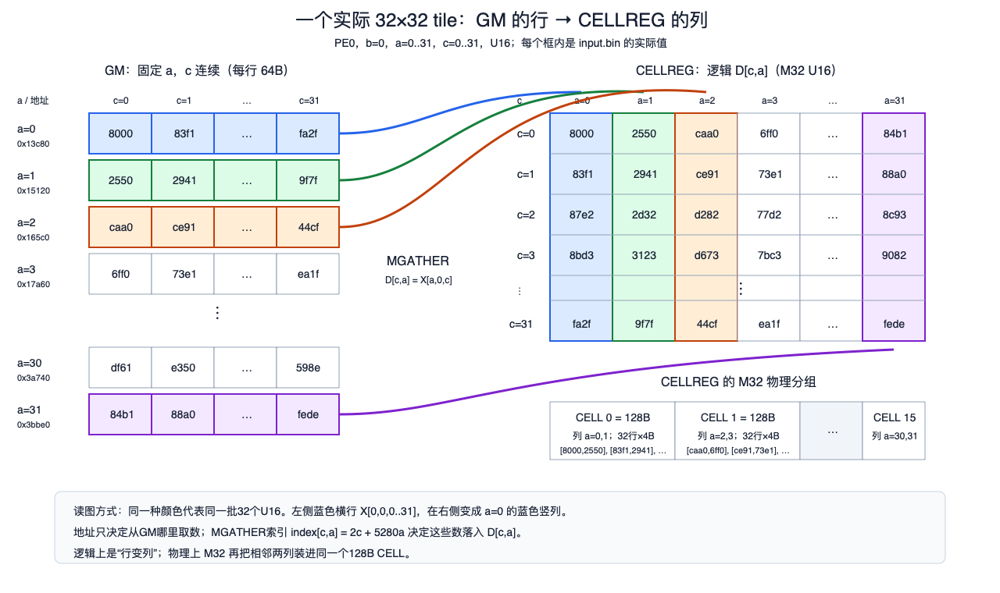
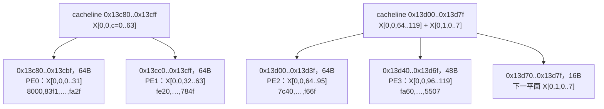

# U16 Transpose：129×22×120 → 120×22×129 分析总结

更新时间：2026-11-03  
对象：4PE、TCI 运行时索引、M32 矩形 MGATHER 实现  
性能结果：66,149 cycles / 36.749 μs @ 1.8 GHz  
目标：80,000 cycles / 44.444 μs

## 1. 结论

该实现的计时结果为 **66,149 cycles**，比 80,000-cycle 目标少 13,851 cycles，周期余量为 **17.31%**。但完整数值校验失败，因此该结果只能作为当前模型中这条数据路径的 timing 数据，不能标记为“数值正确的 transpose 性能”。

性能的主要特征如下：

- MGATHER 的 cacheline 地址序列检查为 440/440 条指令通过；当前检查证明的是 cacheline 地址，不是逐 lane U16 地址和最终输出位置。
- 5,322 条不同输入 cacheline 覆盖 681,120 B 有效输入，首次覆盖的空间利用率为 **99.986%**，cacheline 内部几乎没有浪费。
- 实际发生 10,366 次 128B GM 读取，共 1,326,848 B，是有效输入数据量的 **1.948×**。额外的 5,044 次读取来自 tag 淘汰后的重读。
- MGATHER 红块区间并集为 64,719 cycles。在这些周期内，实测物理 GM 读取带宽为 **20.502 B/cycle**，相当于 128 B/cycle 接口的 **16.02%**。
- GM 平均延迟为 330.75 cycles；平均只有 52.87 条 GM line 请求在途，峰值为 127。跑满 128 B/cycle 需要平均约 331 条请求在途，因此当前并行度不足以覆盖访存延迟。
- 331条128B请求对应 **42,368 B（41.38 KiB）在途GM数据**。当前一个32×32 U16主体结果tile为2,048 B，平均触发29.23次真实GM miss，即约3.65 KiB物理GM读取。要形成331条在途miss，需要约 `331/29.23=11.32` 个主体tile同时贡献请求，折合4PE平均 **2.83个tile/PE**。向上取整为3个tile/PE时，共12个结果tile、物理结果tile容量24 KiB（每PE 6 KiB）；每PE的4 KiB主体索引tile可复用，不需要按结果tile复制。当前只有2个MGATHER/PE一组，理论上不足；4个/PE可以提供容量余量，但仍需实测确认请求确实在时间上重叠。
- 单个 MGATHER 内部发射速度并不低：主体 tile 平均在 25.0 cycles 内产生约 43 个 line 请求，约 **1.72 line请求/cycle**，接近模型 Tag Pipe 的 2请求/cycle。瓶颈主要在 MGATHER 组之间没有持续填满 GM outstanding 窗口。
- 完整数值校验有 336,688 / 340,560 个 U16 不匹配；错误精确呈现“M32 结果 tile 被按行连续方式消费”的布局错位特征。输入输出保护区没有越界破坏。

## 2. 算子与分块

逻辑映射：

```text
输入  X[a,b,c]，shape = [129,22,120]
输出  Y[c,b,a]，shape = [120,22,129]
Y[c,b,a] = X[a,b,c]
```

4 个 PE 沿输入 `c` 轴切分：

| PE | c 范围 | 有效行数 |
|---:|---:|---:|
| PE0 | 0..31 | 32 |
| PE1 | 32..63 | 32 |
| PE2 | 64..95 | 32 |
| PE3 | 96..119 | 24 |

每个 PE 遍历 22 个 `b` 平面；每个平面的 `a=129` 被拆为四个 32 列主体块和一个 1 列尾块：

```text
a = 0..31, 32..63, 64..95, 96..127, 128
```

因此 MGATHER 数量为：

```text
4 PE × 22 个 b × 5 个 a 分块 = 440 条 MGATHER
```

主体 tile 为：

- PE0～PE2：有效 `32×32` U16，物理 `32×32`，2,048 B；
- PE3：有效 `24×32` U16，物理 `32×32`，2,048 B；
- 尾块：有效 `32×1` 或 `24×1`，物理 `32×2`，128 B。

U32 索引使用 M32 layout。每个 PE 生成一次主体索引和尾块索引并重复使用。当前每组先发出 2 条独立 MGATHER，再执行对应 TSTORE。

输入基址与索引公式：

```text
input base = 0x13c80
addr(X[a,b,c]) = 0x13c80 + 2 × (a×2640 + b×120 + c)

tile base = addr(X[a0,b,c0])
index[r,j] = 2×r + 5280×j
```

期望的第 `(r,j)` 个结果元素来自：

```text
X[a0+j, b, c0+r]
```

### 2.1 二维重排图示

以下使用本次实测的第一块数据，不再只画抽象坐标：

```text
PE0，b=0，a0=0，c0=0
有效 tile = 32行(c=0..31) × 32列(a=0..31)，U16
输入数组基址 = 0x13c80
```

下图直接使用输入初始化文件中的真实 U16 数据。左侧每条横行固定 `a`，包含连续的 `c=0..31`；右侧同色竖列是它在 CELLREG 逻辑 tile 中的位置。



MGATHER 对第 `(r,j)` 个元素使用：

```text
GM地址 = 0x13c80 + 2×r + 5280×j
结果   = D[r,j] = X[j,0,r]
```

CELLREG 的物理存储不是把上述逻辑行整体连续放置。M32 U16 每个128B CELL保存 `32行×2列`，所以物理偏移为：

```text
cell       = j / 2
cell内偏移 = r×4 + (j mod 2)×2
tile内偏移 = cell×128 + cell内偏移
```

图中蓝色横行 `X[0,0,0..31]` 的地址为 `0x13c80..0x13cbe`，它成为 CELLREG 的蓝色 `a=0` 竖列；绿色横行 `X[1,0,0..31]` 成为 `a=1` 竖列。物理上这两列交错装入 `CELL0`：`[D[0,0],D[0,1]]`、`[D[1,0],D[1,1]]`，一直到 `[D[31,0],D[31,1]]`。整个32×32 tile以相同方式装入16个 M32 CELL。

### 2.2 cacheline 如何被充分利用

输入的最后一轴 `c` 在 GM 中连续存储。对主体 PE，一个 `a,b` 位置上的32个 `c` 元素正好是：

```text
32 × U16 = 64B
```

一个 cacheline 是128B，因此相邻 PE 处理的两个32元素 `c` 片段经常共享同一条 cacheline。以下仍使用实际输入基址和数据范围：



对应的复用过程是：

```text
一条128B line从GM填充到L2
             │
             ├── 当前PE的MGATHER消费其中一个连续c片段
             ├── 其他PE随后消费同一line中的另一个c片段
             └── 跨b边界的少量尾部字节由后续tile继续消费
```

因此从整个算子看，5,322条不同输入 cacheline 的681,216B覆盖了681,120B有效输入，空间利用率达到99.986%。这说明二维重排虽然在 `a` 方向是稀疏跨步访问，但每个 `a` 列内部沿 `c` 连续读取，并且4个PE及后续 `b` 分块共同消费同一cacheline的剩余部分。

对上面第一条 `0x13c80` cacheline，逻辑复用可以直接写成：

```text
一次GM读取 128B
  ├─ PE0 / tile(b=0,a=0..31) 使用前64B：X[0,0,0..31]
  └─ PE1 / tile(b=0,a=0..31) 使用后64B：X[0,0,32..63]

有效消费 = 64B + 64B = 128B，line利用率 = 100%
```

第二条 `0x13d00` cacheline则由三个时间上分离的 tile 片段消费：PE2使用64B，PE3使用48B，之后 `b=1` 的 PE0 使用剩余16B。只要该line仍留在L2，三个消费者共用一次GM填充；若它在后续消费者到达前被淘汰，就会形成第5节统计的GM重读。

需要区分两种效率：

- **line内空间利用率高**：首次加载的每条line最终几乎全部被使用；
- **L2留存效率不高**：部分line在其他PE或后续 `b` 分块使用前被淘汰，造成5,044次额外GM重读。

所以当前性能问题不是 MGATHER 选取了大量无用 cacheline 字节，而是 cacheline 已经被充分利用后，仍存在重复填充和不足的GM请求并行度。

## 3. 性能及 NDDMA 对比

### 3.1 当前算子

| 项目 | 数值 |
|---|---:|
| 总周期 | **66,149 cycles** |
| 1.8 GHz latency | **36.749 μs** |
| 目标周期 | 80,000 cycles |
| 目标 latency | 44.444 μs |
| 周期余量 | 13,851 cycles / 17.31% |
| 有效输入数据 | 681,120 B |
| 有效输出数据 | 681,120 B |
| 按总周期计算的有效读取率 | **10.297 B/cycle** |
| 按总周期计算的有效读写合计 | **20.594 B/cycle** |

“有效读写合计”只按输入和输出各一次计算，不是实测 GM 总线流量；当前输出数值不正确，因此该值只能用于工作量归一化。

### 3.2 NDDMA 方案的目标带宽需求

以下 NDDMA 对比值按 U16 有效数据量和目标周期计算：

```text
读取 B/C = 元素数 × 2B / 目标cycles
写入 B/C = 元素数 × 2B / 目标cycles
```

它们不包含索引读取、cacheline 重读、写分配等额外流量，也不是本轮 NDDMA 实测 GM 总线计数。

| Shape | NDDMA目标 latency | NDDMA目标 cycles | 读取 B/C | 写入 B/C | 读写合计 B/C |
|---|---:|---:|---:|---:|---:|
| 129×22×120 → 120×22×129 | 44.444 μs | 80,000 | **8.514** | **8.514** | **17.028** |
| 8×4096×3 → 8×3×4096 | 9.63 μs | 17,334 | **11.342** | **11.342** | **22.684** |
| 1476×32 → 32×1476 | 20.29 μs | 36,522 | **2.587** | **2.587** | **5.173** |

### 3.3 129×22×120：NDDMA 与 MGATHER 读取带宽口径

| 口径 | 数据量 | 分母 | 读取 B/C | 说明 |
|---|---:|---:|---:|---|
| NDDMA目标有效读取 | 681,120 B | 80,000 cycles | **8.514** | 达到目标 latency 所需的有效读取率 |
| MGATHER整程序有效读取 | 681,120 B | 66,149 cycles | **10.297** | 只计算一次有效输入 |
| MGATHER红块期间有效读取 | 681,120 B | 64,719 cycles | **10.524** | 红块重叠区间只计一次 |
| MGATHER红块期间物理GM读取 | 1,326,848 B | 64,719 cycles | **20.502** | 包含淘汰后的重读 |

MGATHER 的物理 GM 读取率是 NDDMA 目标有效读取率的 2.408×，但这不表示 MGATHER 获得了更高的有效带宽；其中约一半流量是同一 cacheline 被重新填充。MGATHER 红块期间的有效读取率是 NDDMA 目标的 1.236×。

## 4. L2 请求与 GM 流量

440 条 MGATHER 共分解出 15,254 次 cacheline 请求：

| L2处理结果 | 请求数 | 是否新增GM读取 |
|---|---:|---|
| L2已有数据，BYP命中 | 2,975 | 否 |
| 合并到在途填充，MROB pseudo | 1,913 | 否 |
| L2 miss，MROB填充 | 10,366 | 是，读取128B |
| 合计 | **15,254** | |

实际输入 GM 流量：

```text
10,366 × 128B = 1,326,848 B
```

输入有效数据为 681,120 B，因此：

```text
GM读取放大 = 1,326,848 / 681,120 = 1.948×
有效数据占物理GM流量 = 51.33%
```

## 5. Cacheline 利用率与 5,044 次重读

输入有效区覆盖 5,322 条不同的 128B cacheline：

```text
5,322 × 128B = 681,216 B
```

因此首次覆盖时的空间利用率为：

```text
681,120 / 681,216 = 99.986%
```

cacheline 内部数据利用很好；流量损失主要来自同一 line 被淘汰后重新加载。

| 同一输入line的GM读取次数 | line数量 | 产生GM读取数 |
|---:|---:|---:|
| 1次 | 1,584 | 1,584 |
| 2次 | 2,432 | 4,864 |
| 3次 | 1,306 | 3,918 |
| 合计 | **5,322** | **10,366** |

额外读取次数为：

```text
2,432 × (2-1) + 1,306 × (3-1) = 5,044
```

全部 5,044 次后续填充都能在 L2 trace 中找到之前对应 tag 的淘汰记录：

| 淘汰输入line时替换进入的地址类型 | 次数 |
|---|---:|
| 输出区地址 | 2,990 |
| 其他输入区地址 | 2,054 |
| 合计 | **5,044** |

该分类表示淘汰时的新地址类型，不能直接推导“移除输出访问即可减少2,990次读取”，因为替换顺序改变后整个 cache 状态会变化。

当前 L2 tag 覆盖为：

```text
64 sets × 4 ways × 128B = 32 KiB
```

输入约681 KiB，并与输出流量共享 L2 tag。当前模型普通 ready-hit 路径没有对所有命中执行 LRU touch，因此 5,044 是当前模型的实际重读数，不等价于理想 LRU 必然发生的重读数。

## 6. 单 PE 流量

以下 GM 流量归入真正触发 miss 的 PE；共享 L2 中一个 PE 触发的填充可以被其他 PE 使用，因此该表不能直接解释为各 PE 的逻辑消费量。

| PE | 有效数据量 | MGATHER红块并集 | 触发GM读取量 | GM读取 B/C | 相对平均32 B/C份额 |
|---:|---:|---:|---:|---:|---:|
| PE0 | 181,632 B | 46,889 cycles | 424,832 B | **9.060** | 28.31% |
| PE1 | 181,632 B | 48,490 cycles | 279,808 B | **5.770** | 18.03% |
| PE2 | 181,632 B | 48,712 cycles | 319,488 B | **6.559** | 20.50% |
| PE3 | 136,224 B | 49,057 cycles | 302,720 B | **6.171** | 19.28% |

PE0 触发的填充较多，主要反映请求先后和共享 cache 复用归属，不代表 PE0 的代码读取了更多有效元素。

## 7. MGATHER 是否能覆盖 330±180 cycles 延迟

从 10,366 对 `rd_req → rd_resp` 中得到：

| GM读取延迟 | cycles |
|---|---:|
| 最小 | 151 |
| 平均 | **330.75** |
| 中位数 | 332 |
| P90 | 476 |
| P95 | 493 |
| P99 | 507 |
| 最大 | 510 |

128B cacheline 和 128 B/cycle 接口意味着满带宽需要每周期完成1条 line。覆盖平均延迟所需的平均在途请求数为：

```text
1 line/cycle × 330.75 cycles ≈ 331 lines
```

实际情况：

| 指标 | 实际 | 满带宽所需 |
|---|---:|---:|
| 平均GM line在途 | **52.87** | 约331 |
| 峰值GM line在途 | **127** | 平均需要约331 |
| line完成率 | **0.160 line/cycle** | 1 line/cycle |
| 对应读取带宽 | **约20.5 B/cycle** | 128 B/cycle |

Little's Law 验证：

```text
52.87 / 330.75 = 0.1599 line/cycle
0.1599 × 128B = 20.46 B/cycle
```

与红块并集得到的20.502 B/cycle一致。

在途数量分布：

| 同时在途的GM line | 时间占比 |
|---:|---:|
| 0 | 1.56% |
| 1..31 | 21.95% |
| 32..63 | 39.68% |
| 64..95 | 30.58% |
| 96..127 | 6.24% |
| ≥128 | **0%** |

约63%的时间在途请求不超过63条，从未达到128条，更没有接近约331条的带宽延迟积需求。

## 8. line 发射能力与间歇

主体 MGATHER 的内部 line 生成能力：

| 项目 | 数值 |
|---|---:|
| 主体tile数量 | 352 |
| 每tile line请求 | 40..48，平均43 |
| AGU发完一个主体tile的平均时间 | 25.0 cycles |
| 主体tile活跃时的请求生成率 | **1.72 line请求/cycle** |
| 模型Tag Pipe宽度 | 2请求/cycle |

因此单条 MGATHER 活跃时的地址拆分和 Tag Pipe 发射速度接近结构上限。问题出现在不同批次之间：

| GM发射节奏 | 数值 |
|---|---:|
| GM请求实际发射周期 | 8,666 / 64,843 |
| 有发射的周期占比 | **13.37%** |
| 发射周期内平均请求数 | 1.196 |
| 单周期最大请求数 | 2 |
| 发射间隔中位数 | 1 cycle |
| 发射间隔P90 | 2 cycles |
| 发射间隔P99 | **204 cycles** |
| 最大发射间隔 | **624 cycles** |

当前每 PE 每组只提前发出2条 MGATHER。一个主体 MGATHER 平均触发29.23次真实GM miss，理想情况下每组可产生：

```text
4 PE × 2 MGATHER × 29.23 miss ≈ 234 miss
```

即使完全重叠，也低于平均约331条在途请求的需求；实际还受到PE间启动错位、cache hit、在途合并、TSTORE和分组切换影响，所以平均值只有52.87。

当前模型资源：

| 资源 | 容量/带宽 |
|---|---:|
| MROB | 384 entries |
| BHU下游outstanding | 360 |
| Tag Pipe | 2请求/cycle |
| SL2下游发射 | 2请求/cycle |

资源配置理论上可以容纳约331条在途读取，但本次峰值只有127。因此目前主要矛盾不是MROB/BHU的硬容量，而是算子没有持续填满这些结构。

## 9. 优化方向

### 9.1 “没有持续填满 outstanding 窗口”的含义

当前每个 PE 每组先发出2条独立 MGATHER，等数据返回后执行对应 TSTORE，再开始下一组：

```text
MGATHER tile 0
MGATHER tile 1
等待数据返回
TSTORE tile 0
TSTORE tile 1
开始下一组
```

4PE一组最多包含8个主体MGATHER。一个主体tile平均触发29.23次真实GM miss，因此一组理论上产生：

```text
2 tile/PE × 4 PE × 29.23 miss/tile ≈ 234 miss
```

234低于覆盖330.75-cycle平均延迟所需的约331条在途读取；实际还存在PE启动错位、cache hit、在途合并和TSTORE间隔，所以实测平均只有52.87条、峰值127条在途。

```text
需要：约331条请求长期在途  ─────────────────────

实际：       /\                 /\
            /  \               /  \
           /    \____    _____/    \____
          短突发发射  等待/存储   下一批突发
```

“持续填满”是指旧请求返回时，下一组新请求已经进入GM，使 outstanding 保持在较高水平，而不是等上一组基本排空后才开始下一组。

### 9.2 方案A：每PE从2个MGATHER增加到4个

最直接的候选调度为：

```text
MGATHER tile 0
MGATHER tile 1
MGATHER tile 2
MGATHER tile 3
TSTORE tile 0..3
```

理论miss规模为：

```text
4 tile/PE × 4 PE × 29.23 miss/tile ≈ 468 miss
```

468超过约331条带宽延迟积需求，也超过BHU的360 outstanding容量。实际请求会被MROB/BHU自然限流，但理论上具备把在途数推到250～330区间的容量。

每PE的主体tile资源约为：

| 资源 | 大小 |
|---|---:|
| 4个32×32 U16结果tile | 8 KiB |
| 1个可复用32×32 U32索引tile | 4 KiB |
| 合计 | 约12 KiB/PE |

需要先验证编译器和模型是否允许这些tile同时存活。如果本地CellReg或tile描述符资源不足，group4可能把瓶颈从GM延迟转移到寄存器分配和前端阻塞。

### 9.3 方案B：三缓冲滚动流水

从带宽延迟积看，每PE平均需要约2.83个主体tile同时贡献miss。因此不一定必须固定保留4个结果tile；可以用3个结果buffer滚动执行：

```text
先发出 tile 0、1、2 的MGATHER

循环：
    tile 0返回后开始TSTORE
    同时复用释放出的buffer发出tile 3 MGATHER

    tile 1返回后开始TSTORE
    同时发出tile 4 MGATHER

    始终尽量保持约3个tile/PE在途
```

12个全局主体tile的理论miss数为：

```text
3 tile/PE × 4 PE × 29.23 ≈ 351 miss
```

351略高于约331条需求。资源量为：

| 资源 | 大小 |
|---|---:|
| 3个32×32 U16结果tile | 6 KiB/PE |
| 可复用U32索引tile | 4 KiB/PE |
| 合计 | 约10 KiB/PE |

这种方案比固定group4节省结果tile容量，但代码需要跨当前 `load → save` 分组边界保持tile生命周期。当前结构：

```cpp
p.load(...);
p.save(...);
```

需要改为类似双组或三组滚动：

```cpp
load(group0);
for (...) {
    load(group1);   // 提前发下一组
    save(group0);   // 当前组返回后写出
    swap(group0, group1);
}
```

实际实现必须保证下一组使用独立结果tile，不能覆盖尚未TSTORE的数据；主体索引tile可以复用。

### 9.4 调度与cache局部性的平衡

扩大MGATHER窗口可能增加同一时刻驻留的输入和输出line数量，使32 KiB tag覆盖更加紧张。因此优化时不能只观察cycle，还要同时检查：

- 5,044次输入line重读是否继续增加；
- 不同输入line数量与GM填充次数的比例；
- 输出写流是否更早淘汰仍会被其他PE复用的输入line；
- 每PE的MGATHER起始时间是否过度错开。

优先保持当前沿 `c` 连续、跨PE共享cacheline的访问方式；没有必要通过扩大line内读取范围解决问题，因为首次覆盖的空间利用率已经达到99.986%。

### 9.5 优化后的验收指标

| 指标 | 当前 | 优化期望 |
|---|---:|---:|
| 平均GM outstanding | 52.87 | 提升到约250～330 |
| 峰值GM outstanding | 127 | 接近330～360，但不长期顶满 |
| GM请求发射周期占比 | 13.37% | 显著提高 |
| GM发射间隔P99 | 204 cycles | 显著缩短 |
| 最大发射间隔 | 624 cycles | 显著缩短 |
| MGATHER期间物理GM读取 | 20.502 B/C | 明显提高 |
| 输入line重读 | 5,044 | 不应明显恶化 |
| 完整数值校验 | FAIL | 必须PASS |

MROB容量为384，BHU下游outstanding为360。优化目标不是让队列一直满到无法接收新请求，而是在旧请求返回时持续补入新请求，使平均在途数接近带宽延迟积需要的范围。

最后，在评价优化后的性能前，必须先补齐M32结果布局的端到端数值正确性；否则更低的周期仍只能作为错误结果程序的timing数据。

## 10. 配置与证据

关键配置：

```text
dtype: U16
PE: 4
frequency: 1.8 GHz
read bandwidth limit: 128 B/cycle
write bandwidth limit: 128 B/cycle
ShareTReg bandwidth: 128 B/cycle
GM latency: uniform, mean 330 cycles, half-width 180 cycles
L2 cacheline: 128 B
L2 tag: 64 sets × 4 ways
MROB: 384
BHU outstanding reads: 360
Tag Pipe / downstream width: 2 requests/cycle
```

证据文件：

- `/Users/blacktraker/Programming/gitproj/DV4/SuperNPUBench/outputs/transpose_vec_geometry_fix_20261102/swimlane.json`
- `/Users/blacktraker/Programming/gitproj/DV4/SuperNPUBench/outputs/transpose_vec_geometry_fix_20261102/address.pipeview.log.out`
- `/Users/blacktraker/Programming/gitproj/DV4/SuperNPUBench/outputs/transpose_vec_geometry_fix_20261102/cache_audit/audit.json`
- `/Users/blacktraker/Programming/gitproj/DV4/SuperNPUBench/outputs/transpose_vec_geometry_fix_20261102/cache_audit/REPORT.md`
- `/Users/blacktraker/Programming/gitproj/DV4/SuperNPUBench/outputs/transpose_vec_geometry_fix_20261102/mgather_bandwidth.json`
- `/Users/blacktraker/Programming/gitproj/DV4/SuperNPUBench/outputs/transpose_vec_geometry_fix_20261102/request_review/mgather_request_review.xlsx`
- `/Users/blacktraker/Programming/gitproj/DV4/SuperNPUBench/outputs/transpose_rect_numeric_20261102/result.json`
- `/Users/blacktraker/Programming/gitproj/DV4/SuperNPUBench/outputs/transpose_rect_numeric_20261102/REPORT.md`
- `/Users/blacktraker/Programming/gitproj/DV4/SuperNPUBench/outputs/transpose_mgather_numeric_audit_20261030/configs/fourpe.conf`

模型与ELF信息、运行命令及完整日志保留在上述输出目录中。本总结没有修改编译器或模拟器源码。
